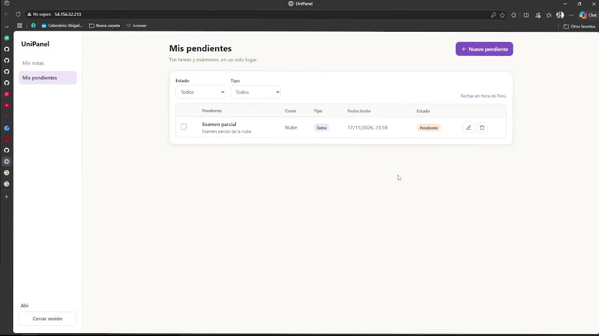

# universitario-front — UniPanel (`uni-panel`)

Front React (Vite) servido por Nginx sin root en el puerto 8080. Pantallas *Mis notas*
(`uni-notas-api`) y *Mis pendientes* (`uni-pendientes-api`). El navegador solo habla con
Nginx, que reenvía `/api/notas` y `/api/pendientes` con la ruta completa. Ver `docs/`.

## Demo en video

[](docs/demo.mp4)

▶️ [Ver el video de la demo (`docs/demo.mp4`, 6 min)](docs/demo.mp4): UniPanel desplegado en K3s
sobre EC2, con *Mis notas* y *Mis pendientes*.

## Desarrollo

```bash
npm ci
npm run dev        # proxy de Vite hacia 127.0.0.1:5000 y 127.0.0.1:3000
npm test
```

Destinos del proxy configurables con `NOTAS_API_URL` y `PENDIENTES_API_URL`.

## Integración local (Docker Compose)

```bash
cp .env.example .env        # completa las contraseñas (solo letras y números) y JWT_KID
mkdir -p secretos           # claves del token (ignoradas por git)
openssl genpkey -algorithm ed25519 -out secretos/jwt-privada.pem
openssl pkey -in secretos/jwt-privada.pem -pubout -out secretos/jwt-publica.pem
docker compose up -d --build
# http://127.0.0.1:8080
docker compose down         # -v borra también los datos
```

Levanta `uni-panel`, `uni-notas-api`, `uni-pendientes-api` (desde `../notas-service` y
`../pendientes-service`) y una PostgreSQL para cada API. Solo se publica `uni-panel`.
Al abrir la app pide **iniciar sesión o crear una cuenta**; cada estudiante ve solo sus datos.

## CI/CD (`.github/workflows/`)

- `ci-publicar.yml`: en pull request hacia `main` ejecuta `./init.sh`; en push a `main`, si pasa,
  publica `ghcr.io/abigaildurand/uni-panel:sha-<12 primeros del SHA>` con el `GITHUB_TOKEN`.
- `servicio-actualizado.yml`: recibe el `repository_dispatch` (`servicio-actualizado`) que envían
  `uni-notas-api` y `uni-pendientes-api` tras publicar su imagen. Valida `servicio`, `imagen`,
  `tag` y `commit` y los muestra en el resumen de la ejecución (pestaña *Actions*).
- Despliegue automático en K3s (EC2): `desplegar.yml`, tras cada merge a `main` (front) o aviso de una API. Ver `k8s/README.md`.
- El aviso lo envía cada API con su secret `PANEL_DISPATCH_TOKEN` (configurado en el repo de
  cada API, no aquí).

## Verificación

```bash
./init.sh
```
